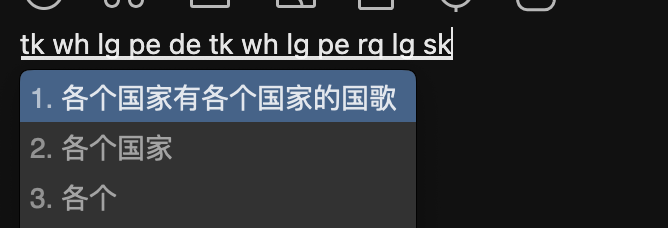
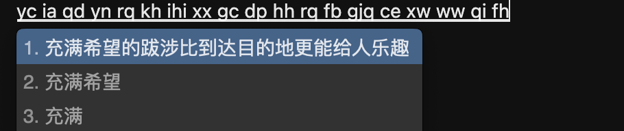
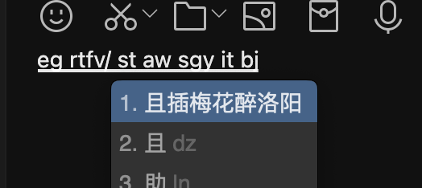
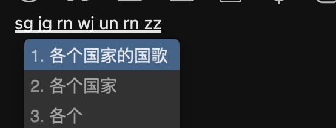
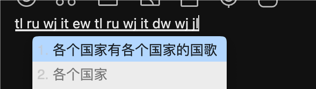
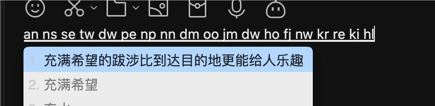
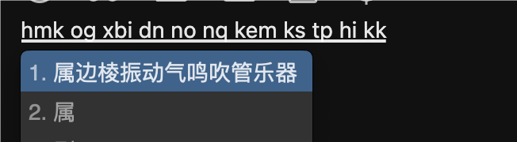
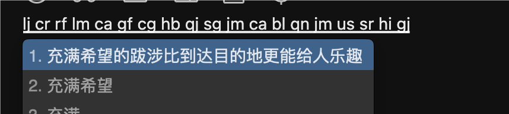

# 说明

修改自墨奇音形<https://github.com/gaboolic/rime-shuangpin-fuzhuma>

尝试一下形码是否可以智能整句输入。词库使用根据雾凇词库修改的白霜词库调整：<https://github.com/gaboolic/rime-frost>

已兼容同一个字不同的编码打法，已兼容3码全码。全码后跟/可以只出单字。

## 分支说明

不同形码方案放在不同分支，master 主仓库只保留五笔；每个分支上都有对应形码的词库、已转换为该形码的白霜细胞词库，以及该方案的 14 键版本。

| 方案 | 分支 | 说明 |
| --- | --- | --- |
| 五笔86 | [master](https://github.com/gaboolic/rime-wubi-sentence/tree/master) | 主分支，五笔86 整句 + 五笔86 十四键 |
| 虎码 | [tiger](https://github.com/gaboolic/rime-wubi-sentence/tree/tiger) | 虎码整句 + 虎码十四键 |
| 字源 | [ziyuan](https://github.com/gaboolic/rime-wubi-sentence/tree/ziyuan) | 字源整句 + 字源十四键 |
| 宇·卿云 | [yucloud](https://github.com/gaboolic/rime-wubi-sentence/tree/yucloud) | 宇·卿云整句 + 十四键 |
| 宇·星陳 | [yustar](https://github.com/gaboolic/rime-wubi-sentence/tree/yustar) | 宇·星陳整句 + 十四键 |

14 键方案参考 [rime-shuangpin-fuzhuma](https://github.com/gaboolic/rime-shuangpin-fuzhuma) 的 `flypymo-14key` 分支：把 26 键形码折叠到 14 键（qw er ty ui op / as df gh jk l / zx cv bn m），候选词注释仍显示原始编码。

白霜拼音的细胞词库已通过 `program/deal_ice_dict_to_cell.py` 转成对应形码词库，放在 `cn_dicts_cell/`；GitHub Action 每天自动同步上游词库并转换，每个分支都会同步。

## 效果

五笔：

虎码：

宇·星陳：

字源：

## 鸣谢

五笔词库 <https://github.com/mrshiqiqi/rime-wubi>

五笔极点词库 <https://github.com/KyleBing/rime-wubi86-jidian>

虎码官网 <https://www.tiger-code.com/>

墨奇音形 <https://github.com/gaboolic/rime-shuangpin-fuzhuma>

雾凇词库 <https://github.com/iDvel/rime-ice>

白霜词库 <https://github.com/gaboolic/rime-frost>

